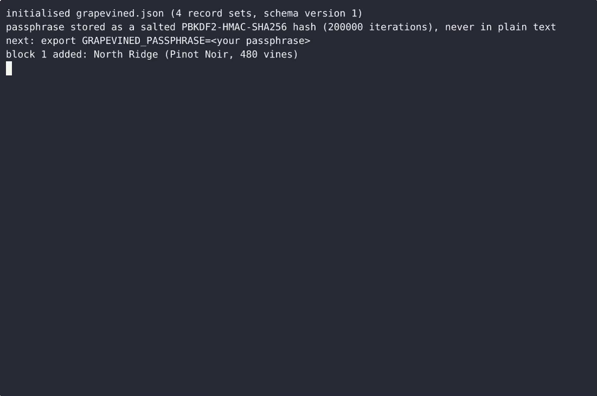
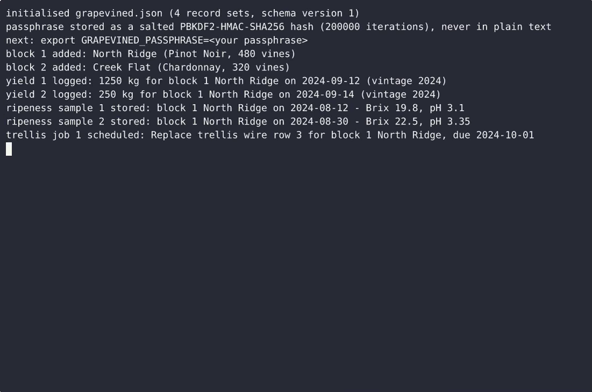

# Grapevined — complete Full-stack app command-line tool example app

Most open-source command-line tool projects ship a skeleton. **Grapevined** ships the whole thing: production-ready Full-stack app source, seeded demo data, and a Grapevined install script that runs in minutes. Grapevined is a single-file, standard-library-only Python command-line tool for a small vineyard: it tracks blocks and their harvest yield, logs harvest ripeness readings (Brix, pH, TA) per block, and schedules trelli…. Apache-2.0-licensed — [remix Grapevined on cenius.ai](https://cenius.ai/marketplace/p/grapevined?ref=gh&utm_campaign=grapevined-webapp) for your own branded build.


[](LICENSE)  [](https://cenius.ai)

[](https://cenius.ai/marketplace/p/grapevined?ref=gh&utm_campaign=grapevined-webapp)

> **▶ [Open & edit in cenius.ai](https://cenius.ai/marketplace/p/grapevined?ref=gh&utm_campaign=grapevined-webapp)** — one click to an editable workspace: describe changes in plain English, get an instant preview, one-click deploy and host. Modifications made on the platform come with full rebrand & relicense rights.

_Local clone? See [Quick start](#quick-start) below. cenius.ai is the zero-setup path._

## Demo


📽 **[Demo video on cenius.ai](https://cenius.ai/marketplace/p/grapevined?ref=gh&utm_campaign=grapevined-webapp)** — the complete run-through · [MP4](.github/media/demo.mp4)

## Screenshots

 

## Features

- Vineyard block yield tracker
- Harvest ripeness log
- Trellis maintenance scheduler

## Quick start

```bash
./install.sh   # installs dependencies + seeds demo data
```

See [`INSTALL.md`](INSTALL.md) for full setup and usage instructions.

## Usage guide

Everything below is run from the directory that holds `grapevined.json`, with

```sh
export GRAPEVINED_PASSPHRASE="your passphrase"      # Windows cmd: set GRAPEVINED_PASSPHRASE=your passphrase
```

in the shell. Output shown is exactly what the tool prints.

### 1. Start a season: the block registry

Blocks are the record every yield entry, ripeness sample and trellis job points
at, so register them first.

```sh
$ python3 grapevined.py block add --name "North Ridge" --variety "Pinot Noir" --vines 480 --rows 8 --planted-year 2016
block 1 added: North Ridge (Pinot Noir, 480 vines)
$ python3 grapevined.py block add --name "Creek Flat" --variety "Chardonnay" --vines 320
block 2 added: Creek Flat (Chardonnay, 320 vines)
$ python3 grapevined.py block list
id  name         variety     vines  rows
--  -----------  ----------  -----  ----
 1  North Ridge  Pinot Noir    480     8
 2  Creek Flat   Chardonnay    320     -
2 blocks
```

Block names are unique case-insensitively, so `--name "north ridge"` is refused
rather than creating a second block that looks the same:

```sh
$ python3 grapevined.py block add --name "north ridge" --variety "Pinot Noir"
error: a block named 'North Ridge' already exists (id 1)
```

`block show` is the one-screen summary you want before a pick decision - it
rolls the block's own records together:

_Full guide: [`USAGE.md`](USAGE.md)_

## Architecture

A self-contained Full-stack app project (26 files): top-level directories include `tests/`. `install.sh` provisions dependencies and seeds demo data so the app starts with something real to explore. See [`INSTALL.md`](INSTALL.md) for complete setup instructions.

## FAQ

### What's the quickest way to self-host Grapevined?

Everything you need ships in this repo: clone it, run `./install.sh` to install dependencies and seed demo data, then follow [`INSTALL.md`](INSTALL.md) to start it. No external services required.

### What powers Grapevined under the hood?

Powered by Full-stack app. This repo is the real thing — full source, seed data, and all — ready to clone and start up. Highlights include harvest ripeness log.

### Can I use Grapevined in a commercial project?

The code is under the Apache-2.0 license, which allows commercial use without restriction. You can build, sell, and deploy it freely. Full text: [LICENSE](LICENSE).

### Is it possible to white-label Grapevined for a client?

White-labeling is supported: fork the MIT-licensed source and rebrand it yourself, or use [cenius.ai](https://cenius.ai/marketplace/p/grapevined?ref=gh&utm_campaign=grapevined-webapp) to make changes in a guided workspace — platform modifications come with full rebrand rights.

### Is Grapevined editable without a developer?

[cenius.ai](https://cenius.ai/marketplace/p/grapevined?ref=gh&utm_campaign=grapevined-webapp) handles the implementation. Tell it what you want in everyday words, pick up the updated build. No coding needed.

## License & rebranding

Released under the [Apache License 2.0](LICENSE) (© 2026 Cenius AI) — free for personal and commercial use. The Cenius name/logo are trademarks (see NOTICE).

**Need a customized version?** [Remix this app on cenius.ai](https://cenius.ai/marketplace/p/grapevined?ref=gh&utm_campaign=grapevined-webapp) — modifications made on the platform come with **full rebrand & relicense rights** over your derivative.

## Built with cenius.ai

This entire application — code, design, seeded demo data — was generated on **[cenius.ai](https://cenius.ai)** from a plain-English description.

- 🚀 [Build your own app on cenius.ai](https://cenius.ai)
- 🎛️ [Remix Grapevined on the marketplace](https://cenius.ai/marketplace/p/grapevined?ref=gh&utm_campaign=grapevined-webapp) — open it in a workspace, prompt for changes, and ship your own version.

More open-source apps: [the Cenius-ai catalog](https://github.com/Cenius-ai) · [showcase index](https://github.com/Cenius-ai/showcase)
